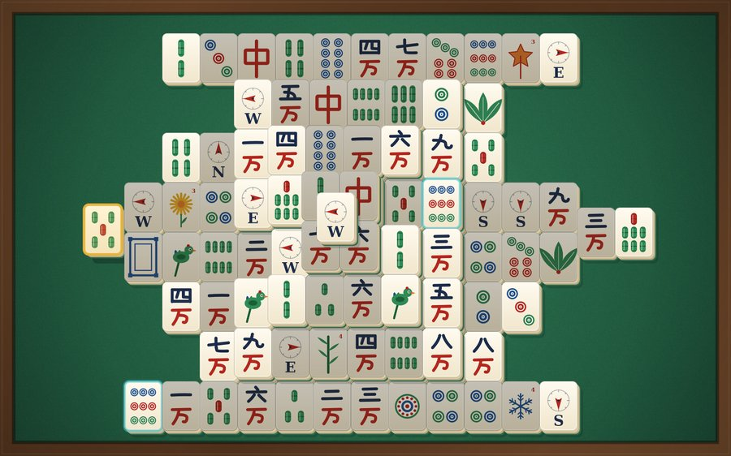
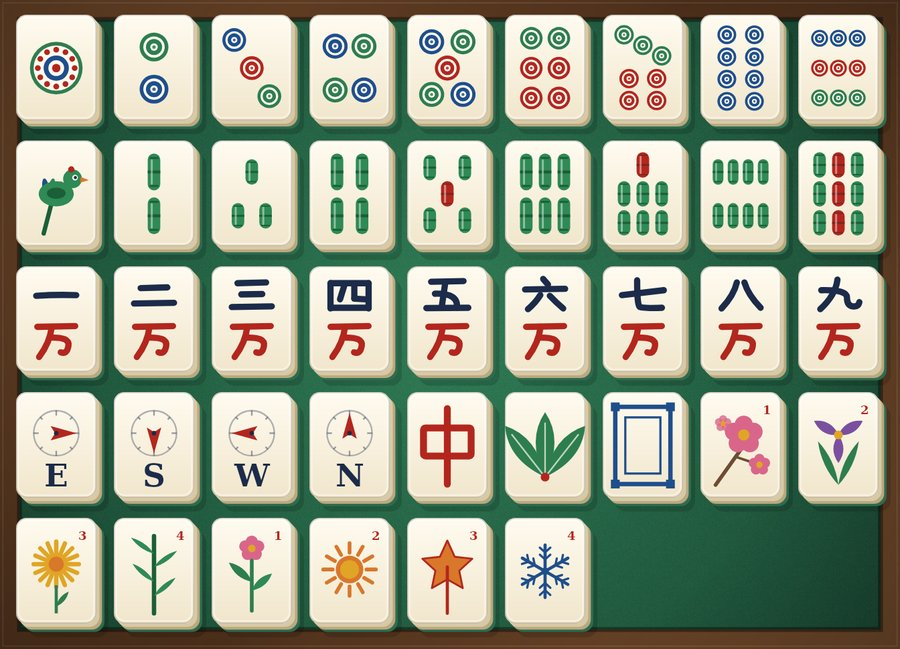

# Mahjong Zen – Mahjong Solitaire für Android

Ruhiges, edles Mahjong-Solitaire (Paare abräumen) in **Kotlin + Jetpack Compose + Material 3**.
Komplett offline, keine Werbung, keine Tracker, **keine Internet-Permission**.

<p>
 
</p>

> Die Bilder sind mit den echten Zeichenfunktionen der App gerendert (alle Motive sind selbst gezeichnete Vektorgrafiken).

## Features

- **144 Kacheln** (Kreise, Bambus, Zeichen 1–9, Winde, Drachen, Blumen, Jahreszeiten); Blumen passen untereinander, Jahreszeiten ebenso
- **7 Layouts**: Schildkröte, Pyramide, Festung, Drache, Brücke, Spinne + **prozeduraler Generator** (zufällige, spiegelsymmetrische Formen)
- **4 Schwierigkeitsstufen** – beeinflussen Ebenen, Kachelzahl, Anzahl gleichzeitig freier Paare, Hinweis-Limit
- **Garantiert lösbare Level** durch Rückwärts-Generierung, **Seed** anzeigen/kopieren/eingeben, **Tägliche Herausforderung**
- Score mit **Combo-Multiplikator**, Seltenheitsbonus, Zeitbonus, Abzügen und **1–3 Sternen**; Highscores pro Layout + Schwierigkeit
- Hinweis, lösbares Mischen, mehrstufiges Rückgängig, Timer, Zug- und Paarzähler, Pausemenü
- **Autosave** – App schließen und genau dort weiterspielen
- Pinch-to-Zoom, Verschieben, Doppeltipp = Zoom zurücksetzen
- Animationen: Anheben beim Antippen, wegfliegende Paare, Partikel bei Combos, Konfetti beim Sieg
- 5 Tische (Filz mit Holzrand, dunkles Holz, Bambus, Nacht, Verlauf), 3 Kachel-Designs (klassisch, modern, hoher Kontrast)
- Selbst synthetisierte Soundeffekte + Ambient-Musik (keine fremden Audiodateien), Haptik
- Deutsch & Englisch (In-App-Sprachwahl), Dark Mode, TalkBack-Unterstützung, Option „Größere Kacheln“
- Hoch- und Querformat, Tablet-tauglich

## Projektstruktur

```
├─ game/            Reines Kotlin/JVM-Modul – die komplette Spiellogik, ohne Android, voll getestet
│  └─ com.mahjongzen.game
│     ├─ model/     TileFace (42 Motive / 36 Match-Gruppen), Slot, Layout, Geometry, Difficulty
│     ├─ layout/    LayoutType (6 feste Layouts je Schwierigkeit), ProceduralLayout, LayoutBuilder-DSL
│     ├─ rules/     Rules: freie Kachel, Matching, verfügbare Paare
│     ├─ gen/       Generator (Rückwärts-Generierung, lösbares Mischen), Solver (unabhängige DFS)
│     ├─ score/     Scoring: Combo, Boni, Abzüge, Zeitbonus, Sterne
│     └─ engine/    GameState (unveränderlich, serialisierbar), GameEngine, Seeds (Täglich)
└─ app/             Android-App
   └─ com.mahjongzen
      ├─ data/      SettingsRepository (DataStore), Room (Statistiken + gespeicherter Spielstand), GameRepository
      ├─ audio/     Synth (prozedurale Klangerzeugung), SoundManager (SoundPool + MediaPlayer)
      └─ ui/        theme, components (Kachel-Motive, Tisch), game (Canvas-Spielfeld, ViewModel, Dialoge),
                    home, levelselect, stats, settings, navigation
```

**Architektur (MVVM):** Compose-Screens beobachten `StateFlow`s ihrer ViewModels. Das `GameViewModel` hält
einen unveränderlichen `GameState` und ruft die reine `GameEngine` auf (Match, Hinweis, Mischen, Undo);
Sounds/Haptik/Animationen laufen über einen Event-`SharedFlow`. Schreibzugriffe auf Room laufen strikt
sequenziell über eine Queue im `AppContainer` (kein DI-Framework nötig).

Das Spielfeld ist **ein einziger Canvas**: Jedes Motiv wird einmal pro Größe in eine Bitmap gerendert und
danach nur noch geblittet – so bleiben 144 Kacheln bei 60 fps. Der Frame-Loop läuft nur, solange eine
Animation sichtbar ist.

## Wie garantiert lösbare Level entstehen

Rückwärts-Generierung: Das Layout startet leer. Wiederholt werden zwei Plätze gewählt, die frei *wären*,
wenn dort eine Kachel läge, und mit einem passenden Paar belegt. Rückwärts abgespielt ist das immer ein
gültiges Spiel. Damit die Generierung nicht in Sackgassen läuft, gibt es drei Regeln:

1. Eine Kachel darf erst auf andere, wenn alles darunter liegt – und nie unter eine schon liegende.
2. **Exakter Totpunkt-Test:** Ein leerer Platz ist verloren, sobald links *und* rechts von ihm (transitiv über die Reihe) schon Kacheln liegen – solche Züge werden verworfen.
3. Reihen mit vielen offenen Plätzen und Plätze unter Stapeln werden bevorzugt (sonst bleibt am Ende eine einzelne Reihe übrig, die pro Paar nur eine Kachel aufnehmen kann).

Die Schwierigkeit steuert, ob die zwei Paare eines Motivs direkt nacheinander (leicht) oder weit
auseinander (Experte) gelegt werden, und aus mehreren Kandidaten wird der mit den meisten bzw. wenigsten
anfangs freien Paaren gewählt. Mischen nutzt denselben Generator auf den verbleibenden Plätzen.

## Score-System

| Regel | Wert |
|---|---|
| Basis pro Paar | 10 |
| Seltenheitsbonus | Winde +5, Drachen +10, Blumen/Jahreszeiten +15 |
| Combo | Paar innerhalb von 3 s nach dem letzten → ×2, ×3 … (max ×5) |
| Schwierigkeitsfaktor | Leicht 100 %, Mittel 125 %, Schwer 150 %, Experte 200 % |
| Zeitbonus | (Par-Zeit − benötigte Sekunden) × 2/3/4/5 |
| Abzüge | Hinweis −20, Mischen −50, Rückgängig −10 (plus Verlust der Paarpunkte) |
| Sterne | 3: unter Par, kein Mischen, ≤ 2 Hilfen · 2: ≤ 1,5 × Par, ≤ 1× Mischen · sonst 1 |

## Tests

```bash
./gradlew :game:test
```

35 Unit-Tests im Logik-Modul: Freie-Kachel-Logik (inkl. Halb-Versatz), Paar-Matching, Layout-Validität aller Layouts ×
Schwierigkeiten, **1000 Seeds generieren und die Lösung Schritt für Schritt gegen die Regeln prüfen**,
unabhängiger Solver über 1000 Boards, Lösbarkeit nach dem Mischen, Score-Berechnung, mehrstufiges Undo,
JSON-Speichern/Laden, Täglich-Seed. Dazu ein App-Unit-Test für die Tages-Serie.

## In Android Studio bauen und aufs Handy installieren

**Voraussetzungen:** Android Studio (Ladybug 2024.2 oder neuer), beim ersten Sync Internet für die
Gradle-Abhängigkeiten. Android SDK 35 installiert Android Studio bei Bedarf selbst.

1. **Öffnen:** Android Studio → *File › Open* → den Projektordner wählen. Gradle-Sync abwarten.
   (Falls Studio ein Upgrade des Android Gradle Plugins vorschlägt, kann man das annehmen – nötig ist es nicht.)
2. **Direkt aufs Handy (am einfachsten):**
   - Am Handy *Einstellungen › Über das Telefon* → 7× auf *Build-Nummer* tippen → Entwickleroptionen aktiv.
   - In den Entwickleroptionen **USB-Debugging** einschalten, Handy per USB verbinden, Verbindung erlauben.
   - In Android Studio oben das Gerät auswählen und ▶ **Run** drücken.
3. **APK bauen:** *Build › Build App Bundle(s) / APK(s) › Build APK(s)*
   oder im Terminal:
   ```bash
   ./gradlew assembleDebug        # → app/build/outputs/apk/debug/app-debug.apk
   ./gradlew assembleRelease      # → app/build/outputs/apk/release/app-release.apk
   ```
   Der Release-Build ist mit dem Debug-Schlüssel signiert, damit er sich direkt installieren lässt
   (für den Play Store einen eigenen Signatur-Schlüssel eintragen).
4. **APK installieren:**
   - per USB: `adb install -r app/build/outputs/apk/debug/app-debug.apk`
   - oder APK aufs Handy kopieren (Kabel, Cloud, …), im Dateimanager antippen und die Installation
     „aus unbekannten Quellen“ für diese App erlauben.

## Hinweise

- Sounds und Musik werden beim ersten Start von der App selbst synthetisiert und im Cache abgelegt –
  keine fremden Audiodateien, keine Lizenzfragen. Sie sind als einfache Platzhalter gedacht.
- Alle Texte liegen in `res/values/strings.xml` (Englisch) und `res/values-de/strings.xml` (Deutsch).
